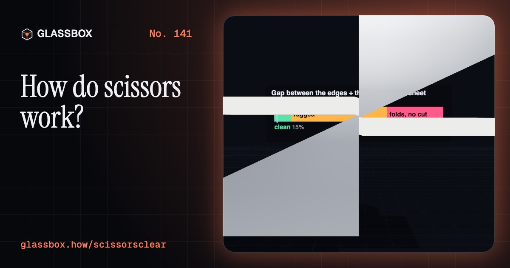
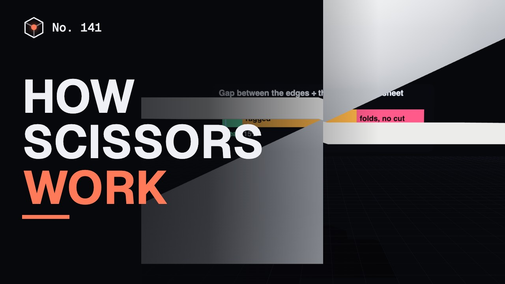
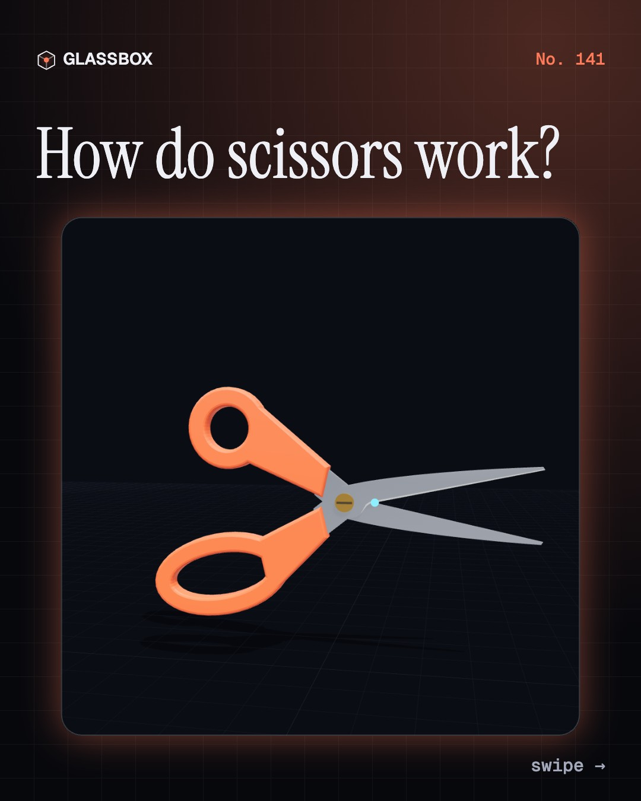
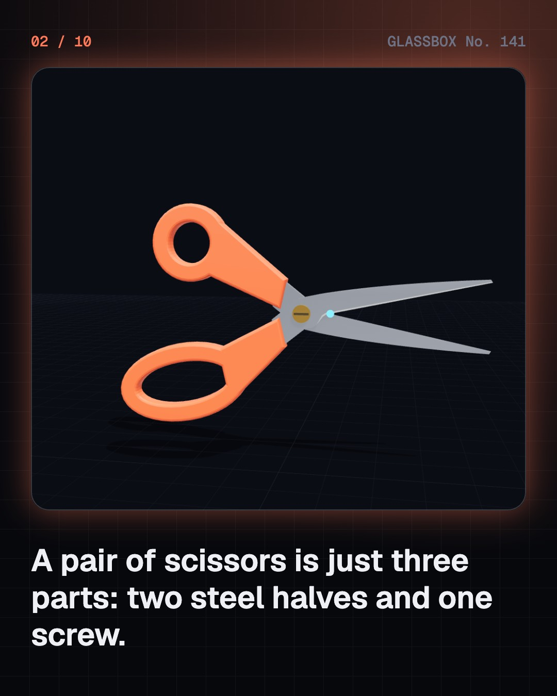
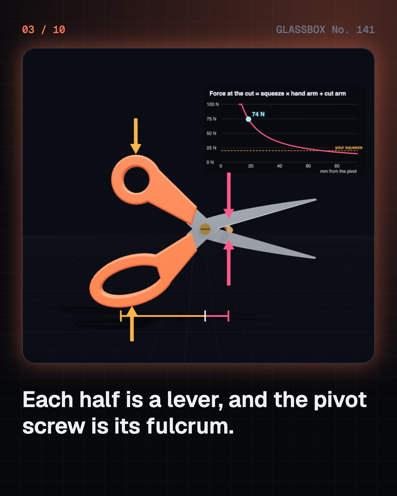
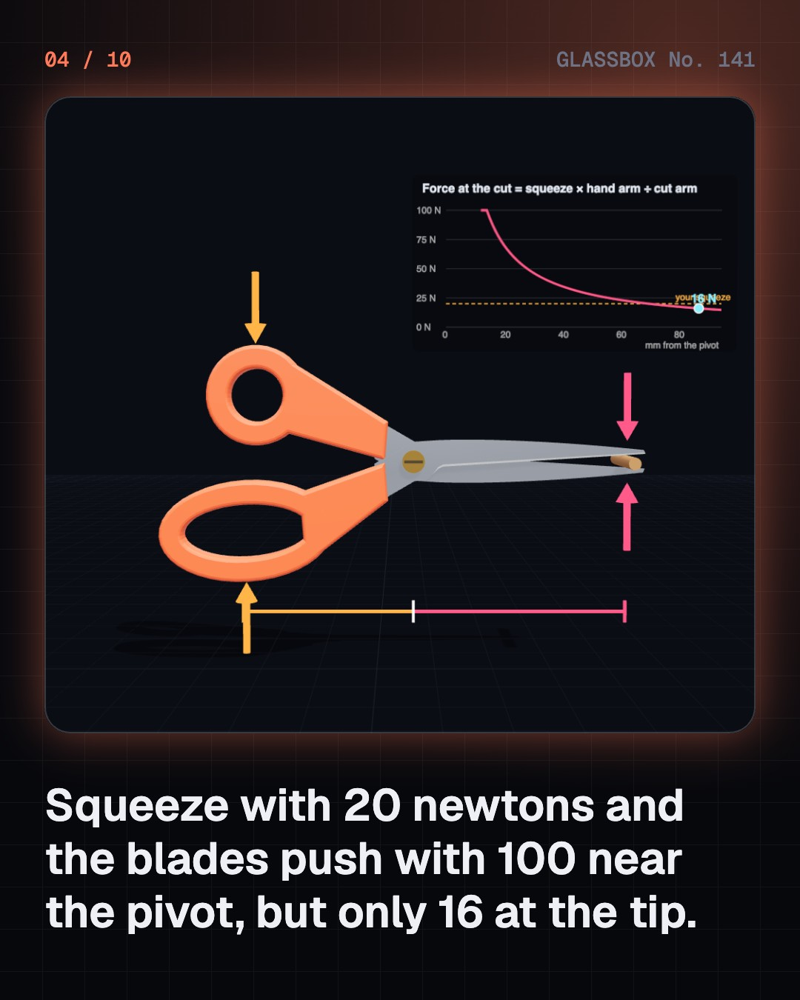

<!-- glassbox:start -->
<!-- Generated from glassbox.json by the Glassbox hub (npm run readme -- scissorsclear). Edit glassbox.json, not this block. -->
<p align="center"><a href="https://glassbox.how/e/scissorsclear/"></a></p>

<h1 align="center">ScissorsClear</h1>

<p align="center"><b>How do scissors work?</b><br>You have used them since nursery school, and they are cleverer than they look. Open up a pair of scissors in 3D: two levers, two edges that pass without meeting, and blades bent on purpose so they touch at one travelling point. Then find out why they fail in a left hand.</p>

<p align="center"><a href="https://glassbox.how/scissorsclear/"><b>▶ Play with it</b></a> &nbsp;·&nbsp; <a href="https://glassbox.how/e/scissorsclear/">Read the 60-second explainer</a> &nbsp;·&nbsp; <a href="https://glassbox.how/scissorsclear/glassbox/reel.mp4">Watch the 40-second video</a></p>

<p align="center">
  <a href="https://glassbox.how/e/scissorsclear/"></a>
  <a href="https://glassbox.how/e/scissorsclear/"></a>
  <a href="LICENSE"></a>
  <a href="LICENSE-CONTENT.md"></a>
  <a href="#privacy"></a>
</p>

## In 60 seconds

1. **Three parts, crossed.** A pair of scissors is two steel halves and one pivot screw. Each half is a blade at the front and a handle at the back. The halves cross at the pivot, so the blade that is on top at the tip belongs to the bottom handle, and a squeeze of the hand closes the blades.
2. **Two levers, one fulcrum.** Each half is a lever that turns about the pivot. Force at the cut = squeeze × hand distance ÷ cut distance. With the hand 70 mm from the pivot, a cut 14 mm out gets five times your squeeze, and a cut at the tip gets less than you give. That is why tough things go deep into the jaws, and why tin snips have long handles and short blades.
3. **A shear, not a slice.** The two edges never meet. They pass each other side by side, pushing the sheet down on one side and up on the other until the thin band between them gives way in shear. Because the edges cross at an angle, only a tiny area is being cut at any instant, so a small force makes a large stress.
4. **One touching point.** The blades are slightly bowed and twisted, so they touch only where the edges cross, and that point runs from the pivot to the tip as you cut. The screw and the ride behind it press the edges together there. Loosen the screw and a gap opens. Once the gap is as wide as the paper is thick, the paper folds instead of cutting.
5. **Why scissors are handed.** A closing hand pushes the thumb handle one way and pulls the finger handle the other. In the matching hand that presses the edges together. In the other hand it levers them apart, and the top blade also hides the cutting line. True left-handed scissors are a full mirror image.
6. **One idea, many tools.** Tailor's shears, pinking shears, tin snips, compound snips and secateurs all use the same lever and the same passing edges, reshaped for the job. Spring shears, the oldest kind, are one bent strip squeezed in the middle: a third-class lever that trades force for movement.

## Words worth knowing

| Term | Meaning |
|---|---|
| **Pivot** | The screw or rivet the two halves turn about. It is the fulcrum of both levers. |
| **Lever** | A stiff bar that turns about a fixed point, trading a small force over a long distance for a big force over a short one. |
| **Mechanical advantage** | How many times a machine multiplies your force. For scissors it is hand distance ÷ cut distance. |
| **Shear** | Sliding one part of a material past the part next to it. Scissors cut by shearing a thin band between two passing edges. |
| **Shear stress** | The shearing force divided by the area it acts on. The sheet gives way when it reaches the material's shear strength. |
| **Set** | The slight bow and twist put into each blade so that the two blades touch only where the edges cross. |
| **Ride** | The small flat behind the pivot where the halves rub. It props them apart there, which presses the edges together in front. |
| **Clearance** | The sideways gap between the edges as they pass. A clean cut needs it to be a small fraction of the sheet's thickness. |
| **True left-handed scissors** | A full mirror image of right-handed scissors, with the blades swapped over as well as the handles. |

## A short history

**About 3,000 years from one bent strip of bronze to orange handles and a protected craft in Meerut.**

- **1500 BCE** · Shears made from one bent strip of bronze (Bronze Age metalworkers, Southwest Asia (Mesopotamia) and Egypt)
- **100** · Two blades cross on a pivot (Roman smiths, Roman Empire)
- **1653** · Meerut starts making scissors (Asli Akhun, by tradition, Meerut, Uttar Pradesh, India)
- **1663** · Zhang Xiaoquan of Hangzhou (Zhang Sijia and his son Zhang Xiaoquan, Hangzhou, China)
- **1761** · Hard, polished cast-steel scissors (Robert Hinchliffe (also spelled Hinchcliffe), Sheffield, England)
- **1893** · Louise Austin patents pinking shears (Louise Austin, Whatcom, Washington, USA)
- **1913** · Steel that does not rust (Harry Brearley, Sheffield, England)
- **1967** · The orange-handled scissors (Olof Bäckström and Fiskars, Fiskars, Finland)

The full story, with 30 moments, charts, people and 43 sources: [glassbox.how/e/scissorsclear/history](https://glassbox.how/e/scissorsclear/history/). The data lives in [`history.json`](history.json).

## Video and slides

Made with the Glassbox studio from this box's storyboard (`window.glassbox.director`). Free to reuse under CC BY 4.0.

<a href="https://glassbox.how/scissorsclear/glassbox/video.mp4"></a>

<p><a href="glassbox/slide-1.jpg"></a> <a href="glassbox/slide-2.jpg"></a> <a href="glassbox/slide-3.jpg"></a> <a href="glassbox/slide-4.jpg"></a></p>

| File | What | Size |
|---|---|---|
| [`glassbox/reel.mp4`](https://glassbox.how/scissorsclear/glassbox/reel.mp4) | Reel / Short, with captions and soundtrack | 1080×1920 |
| [`glassbox/video.mp4`](https://glassbox.how/scissorsclear/glassbox/video.mp4) | YouTube video, with captions and soundtrack | 1920×1080 |
| `glassbox/slide-1…10.jpg` | Instagram carousel | 1080×1350 |
| `glassbox/thumb.jpg` | YouTube thumbnail | 1280×720 |
| `glassbox/cover.jpg` | Share card and repo social preview | 1200×630 |
| [`glassbox/history-reel.mp4`](https://glassbox.how/scissorsclear/glassbox/history-reel.mp4) | “History in 10 moments” Reel / Short | 1080×1920 |
| `glassbox/history-slide-*.jpg` | History carousel | 1080×1350 |
| `glassbox/post.json` | Post copy and schedule used by the publish kit | |

## Privacy

This box has no accounts and no ads, and it ships its own fonts and libraries. When you run it yourself it sends nothing anywhere. On glassbox.how, the site's `/bar.js` also loads Glassbox's analytics: **Google Analytics** to count visits (it asks first in the EU, UK and Switzerland, and stays off when your browser sends Global Privacy Control or Do Not Track) and **ClickTrust** to detect bots.

It remembers a few things **in your own browser only**, and never sends them anywhere:

| Browser storage key | What it holds |
|---|---|
| `scissorsclear.v1` | Which chapters you have opened, your best quiz scores, and sound on or off. |

Exactly what each one sees is at [glassbox.how/privacy](https://glassbox.how/privacy/).

## Licences

- **Code:** [MIT](LICENSE). Use it, change it, ship it.
- **Explanations, text, images and videos** (`glassbox.json`, `glassbox/`): [CC BY 4.0](LICENSE-CONTENT.md). Credit “Glassbox, glassbox.how/e/scissorsclear”.
- **Third-party parts** keep their own licences: [three.js](https://threejs.org) (MIT), [Geist, Instrument Serif](https://openfontlicense.org) (SIL OFL 1.1).
- The Glassbox name and logo aren't covered by either licence. See the [terms](https://glassbox.how/terms/).

Found a mistake? [Open an issue](https://github.com/bdeeps/scissorsclear/issues). Corrections happen in public.
<!-- glassbox:end -->

## Run it

It's plain HTML, CSS and JavaScript. No build step and no dependencies. Run locally, it contacts no other website.

```bash
python3 -m http.server 8000
```

Three.js and the fonts ship in `vendor/` and `fonts/`, so it also works offline.

Then open http://localhost:8000.

## How it's built

| File | What |
|---|---|
| `index.html`, `css/app.css` | The page and its styles |
| `js/app.js`, `js/stage.js`, `js/ui.js`, `js/kit.js` | The shared Glassbox 3D engine: chapters, 3D stage, controls, quiz, video director |
| `js/scissors.js` | Shared scissors parts: sizes, the lever, shear and three-point "set" physics, and the 3D builders for scissors, snips, secateurs and spring shears |
| `js/chapters/*.js` | One file per chapter: the 3D model, controls, text, key terms, quiz and video scenes |
| `glassbox.json` | Title, question, explainer beats, key terms, browser storage and credits shown on glassbox.how |
| `reel` in each chapter | The storyboard the Glassbox studio records into short videos |
| `glassbox/` | The published video, slides, thumbnail and post copy |
| `fonts/`, `vendor/three/` | Self-hosted Geist and Instrument Serif (SIL OFL 1.1) and three.js (MIT) |
